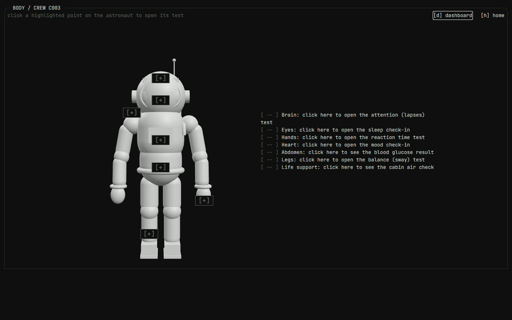

# LastCommit: FARSIDE

FARSIDE is a crew health station where the communication delay to Earth decides who acts on a health finding. The same reading means "message Earth" on the ISS and "crew medical officer acts now" on Mars.

Built by Team Last Commit for HackAthlone 2026 (NASA Space Apps Challenge).

**Live site:** https://lastcommit.earth (dashboard at https://lastcommit.earth/demo)

> Decision support, not diagnosis. Values from the Wokwi simulation are simulated; the demo scenario values are invented demo numbers.

## Preview

| Landing | Dashboard (`/demo`) | Body view (`/demo#body`) |
|---|---|---|
|  |  |  |

Screenshots from a local build of `main`, without the bridge running (so the dashboard shows the replay badge and "bridge unreachable").

## How it works

1. **Readings** come from the station (Arduino STAND-REACT test), the bridge's replay scenarios or the Wokwi simulation. Every reading has exactly six fields: `crew_id, timestamp, type, value, unit, source` (`docs/schemas.md`).
2. **Rules engine** (in the browser): `score(readings, crewId)` grades each indicator against `data/knowledge.json` and the crew member's own baseline. `evaluate(readings, crewId, missionId)` returns the `EngineResult` (`docs/engine_contract.md`).
3. **Router**: `route(worst, missionId)` in `app/src/engine/triage.ts` picks the tier from the worst finding and the mission's round trip (`app/src/engine/delay.ts`):

| Tier | Station LED | Who acts |
|---|---|---|
| 0 | off | nobody |
| 1 | green | crew self-care (amber finding) |
| 2 | amber | crew medical officer acts now (red finding, round trip over `SAFE_WAIT_S = 600` s or no link) |
| 3 | red | message Earth (red finding, round trip 600 s or less) |

| Mission | Round trip |
|---|---|
| `iss` | 0.5 s |
| `moon` | 2.6 s |
| `mars` | 2640 s (44 min, shown at 60x speed) |
| `conjunction` | no link |

4. **Station sync**: the app sends the engine tier unchanged to the station (`POST /tier`, `POST /msg`). The bridge never runs the engine.
5. **On-board assessment**: `POST /assess` (`bridge/assess.py`) asks Claude (or Gemini) for a plain-language summary. The AI never changes the tier. With no key, no network or no answer in 15 s it falls back to `bridge/assess_cache.json` and says "cache".

The stress model and the stress/mood check never set a tier. Cabin air is environment data, never a crew reading.

## What's in the app

- **Dashboard** (`/demo`): status card (tier, who acts, what to do, why), Earth reply and outbox countdown, on-board vs Earth panel, STAND-REACT test strip with live taps, mission selector, crew selector, keyboard shortcuts.
- **Body view** (`/demo#body`): 3D astronaut; each part opens its test (attention, sleep, reaction time, mood, blood glucose with NASA baseline, balance, cabin air).
- **Panels**: Inspiration4 baseline panel, stress/mood check, solar event banner (cached DONKI), cabin air, sensor strip and report (Simulation mode).

## Repo layout

```
app/        React + Vite + TypeScript app (deployed to Vercel)
  src/engine/      score.ts, rules.ts, triage.ts (router), delay.ts (missions)
  src/components/  one folder per panel
  src/data/        copies of data/ files used by the app (must equal data/*)
bridge/     FastAPI bridge: serial station, replay, stress feed, Wokwi sim replay, /assess
firmware/   Arduino Uno station (stand_react/), module tests (tests/)
data/       NASA DONKI cache, OSDR Inspiration4 baselines, knowledge.json, scenarios, scripts
ml/         WESAD stress model (physio-only), replayed stress feed
docs/       schemas, engine contract, knowledge schema, delay table, decisions, screenshots
pitch/      demo script, threshold sources, backups
```

## Setup (Windows PowerShell)

```powershell
python -m venv .venv
Set-ExecutionPolicy -Scope Process -ExecutionPolicy RemoteSigned
.\.venv\Scripts\Activate.ps1
pip install -r bridge\requirements.txt
pip install requests pandas   # for the data scripts

cd app
npm install
```

Keys go in a `.env` file in the repo root. `.env` is gitignored. Never commit it.

```
NASA_API_KEY=...        # DONKI scripts (free at https://api.nasa.gov)
ANTHROPIC_API_KEY=...   # /assess with Claude (optional)
GEMINI_API_KEY=...      # /assess with Gemini if no Anthropic key (optional)
```

## Run

| Task | Command |
|------|---------|
| App (dev) | `cd app; npm run dev` |
| Bridge with the station | `python bridge\serial_bridge.py --port COM5` |
| Bridge without hardware | `python bridge\serial_bridge.py --fake` |
| Mock bridge (replay only) | `cd bridge; uvicorn mock_server:app --port 8000` |
| Wokwi feed replay | `POST http://localhost:8000/sim` with `{"scenario":"hypoxia"}` (see `bridge/README.md`) |
| Record the AI cache | `python bridge\assess.py --record` |

Station wiring and firmware upload: `firmware/README.md`.

## Checks

| Changed | Run |
|---|---|
| `app/` | `cd app; npm test; npm run build` |
| `data/knowledge*`, `data/baselines*` | `python data/validate.py`, `python data/score_reference.py`, `python data/make_parity_cases.py` |
| A readings file | `python data/check_readings.py <file>` |
| `bridge/` | `python bridge/test_station.py`, `python bridge/test_stress.py`, `python bridge/test_sim.py`, `python bridge/test_assess.py` |

## Data sources

- **NASA DONKI** solar particle events: https://api.nasa.gov/DONKI/SEP. 14 events for May 2024 cached in `data/donki_cache.json`, shown on screen as "cached". Solar flares (FLR) were unreachable and are not used (`data/README.md`).
- **NASA OSDR Inspiration4** complete blood count (OSD-569) and comprehensive metabolic panel (OSD-575): https://osdr.nasa.gov/bio/repo/data/studies/OSD-575. Anonymised crew IDs C001 to C004; no names are stored.
- **WESAD** for the stress model (physio-only, leave-one-subject-out accuracy 91.6%). The dataset is not in the repo.
- Thresholds: NEWS2 and NASA standards, listed in `pitch/threshold_sources.md`. `SAFE_WAIT_S = 600` is a design choice informed by NASA/TM-20250003885.

## Data and evidence (OSDR and thresholds)

**What worked**
- Both Inspiration4 clinical files (OSD-575 CMP, OSD-569 CBC) download and parse with pandas.
- 48/48 pre-flight rows in `data/raw/*_extract.csv` match NASA's rows exactly (checked 2026-11-14). The SHA-256 of both full files is recorded in `baselines.json`.
- `baselines.json` (C001-C004: glucose, calcium, WBC, haemoglobin), `osdr_readings.json` (same draws as `reading` objects), `knowledge.json` v0.2 (5 indicators plus `lapses`).
- `python data/validate.py` checks all of it against the schemas. `python data/score_reference.py` runs 24 tests of the scoring rules.

**What failed / watch**
- If NASA's download URL breaks, save the files into `data/raw/` by hand. `fetch_osdr.py` last ran on 2026-11-14; checksums match.
- C003 L-92 CBC columns are shifted in NASA's file (platelets 12.9, MPV 330). Excluded. C003 CBC uses male reference ranges.
- R+45 glucose is 36-44 mg/dL for 3 of 4 crew. Unexplained; not used.
- Some `knowledge.json` fields are still UNSOURCED (list: `python data/validate.py`). Mood, sway, min spreads and action text are the biggest gaps. High-glucose red limit (250) is a placeholder.

**Rebuild:** `python data/fetch_osdr.py && python data/build_baselines.py && python data/validate.py`

**Design choices to confirm:** see `docs/knowledge_schema.md` (bad-direction z instead of |z|; red without z; sleep red = 3 nights at 6 h or less).

## Team

| Person | Area |
|---|---|
| Shreya (`settys-trinity`) | Frontend lead, app shell, dashboard, station sync, deploy; merges PRs |
| Om | Integrator: triage router, mission table, docs, `/assess`; approves PRs |
| Ansh (`Ansh-0403`) | Rules engine, knowledge and baselines, evidence, demo backups |
| Nandini (`NandiniLashkari`) | Stress model, Earth outbox, mission selector, sensors report |
| Daksh | Station hardware, firmware, serial bridge, Simulation mode |
| Diksha (`dik17sha`) | Pitch, dashboard redesign, Wokwi recordings |

Decisions: `docs/decisions.md`. Rules for contributors and AI agents: `CLAUDE.md`.
