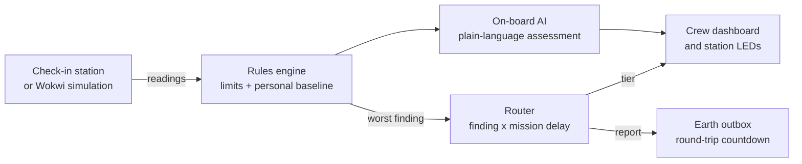

# FARSIDE

### Crew health decision support for missions beyond real-time contact with Earth

**Same data. Different distance. Different decision.**

[Live demo](https://lastcommit.earth/demo) · [Wokwi simulation](https://wokwi.com/projects/480704307052933121) · Built by Team Last Commit for HackAthlone 2026 (NASA Space Apps Challenge)


---

## The problem

Every crewed mission so far has had a doctor on the line. Low Earth orbit and lunar missions rely on **real-time support from flight surgeons on the ground**: the ISS is less than a quarter of a second away and the Moon about 1.3 seconds one way. When a crew member's health changes, the crew describes it and Earth decides what to do.

Mars breaks that model:

- **Up to 22 minutes one way, 44 minutes round trip.** A question asked at the start of a medical event gets its answer three quarters of an hour later.
- **No link at all during solar conjunction.** For about 2 to 3 weeks per Mars mission, the Sun blocks communication.
- **Past roughly 10 minutes of delay, NASA expects the crew to manage on their own** (NASA/TM-20250003885).

Today's crew health tools grade a reading as normal or abnormal. None of them answers the question that matters on Mars: **who acts on this finding, and how fast?** A low oxygen saturation that should be reported to Earth from the ISS needs the crew medical officer to act immediately on Mars. If that switch is left to judgement in the moment, under stress and with incomplete information, the crew loses the time that matters most.

## Our solution

FARSIDE is a crew health station that makes **communication delay part of the medical decision**.

1. It checks each crew member's readings against **sourced clinical limits and their own personal baseline**.
2. It routes the worst finding using the **round-trip delay of the current mission**, so the same reading leads to "message Earth" near home and "crew medical officer acts now" far from it.
3. It gives the crew a **plain-language explanation in seconds**, while the report is still travelling to Earth, and shows exactly when the ground reply will arrive.

FARSIDE is decision support, not diagnosis. A transparent rules engine sets every decision. The AI only explains it.

## Preview

| Landing page | Body view |
|---|---|
|  |  |

The dashboard (top) shows the status card, who acts, what to do now, the Earth reply countdown and the reaction test. The body view links each part of the astronaut to its test.

## How it works



| Step | What happens |
|---|---|
| **Measure** | The station runs a 20-second reaction and balance test and reads cabin air. The Wokwi simulation adds SpO2, heart rate, breathing rate, blood pressure, skin temperature, posture and cabin CO2. |
| **Score** | Each reading is graded green, amber or red against published limits (NEWS2, NASA standards, PVT research) and the crew member's own pre-flight baseline. |
| **Route** | The worst finding and the mission's round trip decide who acts. The decision runs entirely on board. |
| **Explain** | An on-board AI assessment summarises the findings and next steps in plain language. It never changes the decision, and it falls back to cached answers with no connection. |
| **Report** | A report packet goes to Earth. The crew sees when it arrives and when a reply can come back. |

### Decision model

| Worst finding | Round trip 10 min or less (ISS, Moon) | Round trip over 10 min, or no link (Mars, conjunction) | Station LED |
|---|---|---|---|
| Normal | Nobody needs to act | Nobody needs to act | Off |
| Amber | Crew self-care | Crew self-care | Green |
| Red | **Message Earth**: a flight surgeon decides | **Crew medical officer acts now** | Red / Amber |

The 10-minute threshold is our design choice, informed by NASA's notional figure. The decision does not depend on its exact value: the ISS (0.5 s) and Moon (2.6 s) sit far below it, and Mars (44 min) far above it.

### Mission profiles

| Mission | Round trip | Source |
|---|---|---|
| ISS | 0.5 s | Rucker et al., IAC 2019 |
| Moon | 2.6 s | NASA/TM-20250003885 |
| Mars (far side) | 44 min | NASA/TM-20250003885, AIAA ASCEND 2022 |
| Mars solar conjunction | No link | AIAA ASCEND 2022 |

Mars is shown at 60x speed in the demo, so the 44-minute countdown runs in 44 seconds.

## Wokwi simulation

**[Open the simulation on Wokwi](https://wokwi.com/projects/480704307052933121)**

The Wokwi project is the full target station: an ESP32 with **8 health channels**, a crew display, a wrist watch and an Earth link model. It runs in any browser with no hardware. It uses the same decision rule as the app. Source: [`firmware/wokwi/`](firmware/wokwi/).

| Channel | Simulated with | Limits based on |
|---|---|---|
| Blood oxygen (SpO2) | Slider | NEWS2 |
| Heart rate | Slider | NEWS2 |
| Breathing rate | Slider | NEWS2 |
| Systolic blood pressure | Slider | NEWS2 (low) |
| Skin temperature | DHT22 sensor | Design choice |
| Posture | MPU6050 accelerometer | Design choice |
| Cabin CO2 | Slider | NASA-STD-3001 and SMAC limits |
| Reaction time | Button and LED (5-tap test) | Design choice, informed by PVT research |

What it shows:

- **Seven clinical scenarios:** Nominal, Hypoxia, CO2 build-up, Fatigue, Cardio, Heat stress and Orthostatic. Each one develops from baseline through onset to a plateau, with realistic noise.
- **Crew display (ILI9341):** a colour tile per channel with trend arrows, who acts, an ECG trace and Earth link status.
- **Mars distance slider:** sets the round trip anywhere from 6 to 44 minutes. Who acts is recalculated live as the delay crosses the threshold.
- **Forecast:** an estimate of the time until a channel turns red, from its recent trend.
- **Earth link model:** report packets, one-way travel time, ground reply, and store-and-forward when there is no link.
- **Wrist watch (OLED):** alarm, acknowledge, and a 1-minute guided box breathing exercise.
- **Clinical safety details:** partial NEWS2 score, limits that alarm fast and clear slowly, and sensor fault handling.
- **Serial output:** one JSON line per second. The bridge can record and replay it into the app's Simulation mode.

**Controls:** blue button cycles the mission, yellow cycles the scenario, white starts the reaction test, green acknowledges an alarm or starts box breathing. All physiological values in the simulation are simulated.

## Hardware station

The physical check-in station runs the **STAND-REACT** test on an Arduino Uno R3:

- **Reaction time and lapses:** the crew member taps a touch pad when the OLED shows "TAP!" for 20 seconds. A tap slower than 355 ms counts as a lapse (PVT-B, Basner et al. 2011).
- **Balance:** an ADXL345 accelerometer worn at the sternum measures sway while standing.
- **Cabin air:** a gas sensor tracks change in cabin air quality. It is environment data, never a crew reading.
- **Tier LEDs:** green, amber and red LEDs show the engine's decision, and the OLED shows who acts.

The station connects to the app through a Python bridge over USB serial.

## Features

- **Mission selector:** ISS, Moon, Mars and Mars solar conjunction, with the decision updating instantly.
- **Earth outbox:** every report packet with a live round-trip countdown and the ground reply when it arrives.
- **On board vs Earth:** the on-board assessment beside the ground diagnosis, so every reply from Earth can be compared with what the crew did.
- **Interactive 3D astronaut:** each body part opens its test: attention, sleep, reaction time, mood, blood glucose, balance and cabin air.
- **Personal baselines:** each crew member is compared with their own pre-flight values, not only a population range.
- **Stress and mood check:** a stress model on physiological signals, shown as a flag that never changes the tier.
- **Solar event alerts:** NASA DONKI solar particle events.
- **Works offline:** the decision runs locally, and the AI assessment falls back to cached answers.

## Data and evidence

| Source | Used for |
|---|---|
| [NASA OSDR Inspiration4](https://osdr.nasa.gov/bio/repo/data/studies/OSD-575) (OSD-569 blood count, OSD-575 metabolic panel) | Pre-flight personal baselines for 4 anonymised crew members |
| [NASA DONKI](https://api.nasa.gov/) | Solar particle events |
| [NEWS2](https://www.rcp.ac.uk/improving-care/resources/national-early-warning-score-news-2/) (Royal College of Physicians) | Alert limits for SpO2, heart rate, breathing rate and blood pressure |
| [NASA-STD-3001](https://www.nasa.gov/wp-content/uploads/2023/12/ochmo-tb-004-carbon-dioxide.pdf) and SMAC | Cabin CO2 limits (3 mmHg, about 3,950 ppm; 5.3 mmHg, about 7,000 ppm) |
| [Basner, Mollicone & Dinges 2011](https://pmc.ncbi.nlm.nih.gov/articles/PMC3197786) | 355 ms lapse threshold for the reaction test |
| NASA/TM-20250003885, AIAA ASCEND 2022, Rucker et al. 2019 | Mission communication delays |
| WESAD | Training data for the stress model |

Every limit is labelled in the data as sourced, design choice or unsourced, and the app says when a value is simulated or cached.

## Tech stack

| Layer | Technology |
|---|---|
| App | React 19, TypeScript, Vite, Three.js, Tailwind CSS, deployed on Vercel |
| Rules engine | TypeScript, runs in the browser, tested with Vitest |
| Bridge | Python, FastAPI, WebSockets, pyserial |
| On-board assessment | Claude (Anthropic) or Gemini, with an offline cache |
| Stress model | scikit-learn, LightGBM, NeuroKit2 |
| Hardware | Arduino Uno R3, ADXL345, SSD1306 OLED |
| Simulation | ESP32 on Wokwi, ILI9341, SSD1306, DHT22, MPU6050 |

## Run locally

**App**

```bash
cd app
npm install
npm run dev
```

**Bridge** (second terminal, from the repo root)

```bash
pip install -r bridge/requirements.txt
python bridge/serial_bridge.py --fake        # no hardware
python bridge/serial_bridge.py --port COM5   # with the station plugged in
```

Open the app, go to `/demo`, and pick a mission. Without the bridge, the app runs in replay mode.

For station wiring and firmware upload, see [`firmware/README.md`](firmware/README.md).

## Limitations

- FARSIDE is a hackathon prototype for decision support. It is not a medical device and does not diagnose.
- Simulated and demo values are labelled as such. The physical station measures reaction time, balance and cabin air only.
- In this prototype the on-board assessment uses a cloud model. On a mission it would run on hardware carried by the crew.
- The 10-minute safe-wait threshold is a design choice informed by NASA's notional figure.
