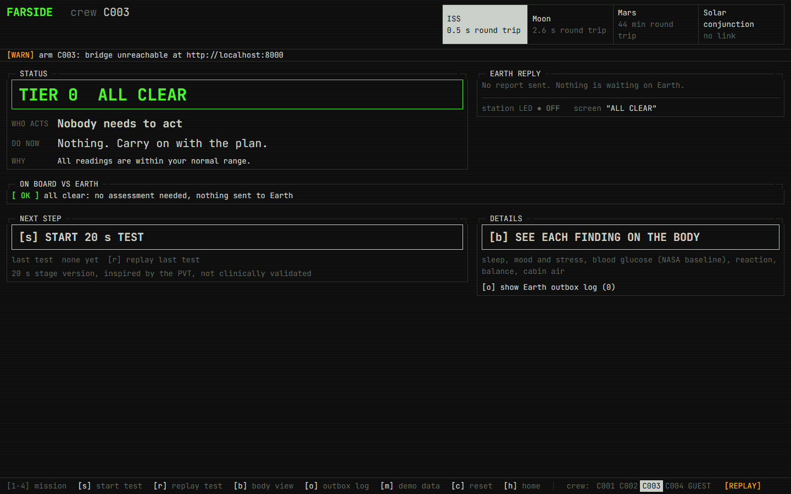
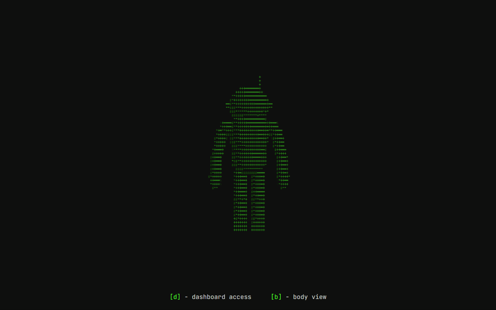

# FARSIDE

**Same data. Different distance. Different decision.**

FARSIDE is a crew health station for deep-space missions. It checks an astronaut's readings against their own baseline, then uses the communication delay to Earth to decide who should act. On the ISS a red finding goes to a flight surgeon on Earth. On Mars, where a reply takes 44 minutes, the crew medical officer acts now.

Built by Team Last Commit for HackAthlone 2026 (NASA Space Apps Challenge).

**Live demo:** [lastcommit.earth/demo](https://lastcommit.earth/demo)



| Landing | Body view |
|---|---|
|  |  |

## How it works

1. **Measure.** A check-in station runs a 20-second reaction and balance test (STAND-REACT) and reads cabin air. A Wokwi simulation shows the full 8-channel set: SpO2, heart rate, breathing rate, blood pressure, skin temperature, posture, cabin CO2 and reaction time.
2. **Score.** A rules engine grades each reading against sourced limits and the astronaut's personal baseline.
3. **Route.** The worst finding plus the mission's round-trip delay decides who acts:

| Finding | ISS / Moon (round trip under 10 min) | Mars / no link |
|---|---|---|
| Normal | Nobody | Nobody |
| Amber | Crew self-care | Crew self-care |
| Red | Message Earth | Crew medical officer acts now |

4. **Explain.** An on-board AI assessment explains the result in plain language within seconds, while the report travels to Earth. The AI never changes the decision; it falls back to a cached answer with no connection.

## Features

- Mission selector: ISS, Moon, Mars, Mars solar conjunction
- Earth outbox with a live round-trip countdown
- Interactive 3D astronaut: each body part opens its test
- Personal baselines from NASA Inspiration4 bloodwork
- Stress and mood check, solar event alerts, cabin air monitoring
- Physical station with tier LEDs and an OLED display

## Data sources

- [NASA OSDR Inspiration4](https://osdr.nasa.gov/bio/repo/data/studies/OSD-575): pre-flight blood panels (OSD-569, OSD-575) for personal baselines
- [NASA DONKI](https://api.nasa.gov/): solar particle events
- WESAD: stress model training data
- NEWS2 and NASA health standards: alert limits

Simulated values are labelled as simulated. FARSIDE is decision support, not diagnosis.

## Tech stack

React, TypeScript, Vite, Three.js (app, on Vercel) · Python, FastAPI (bridge) · Arduino Uno and ESP32 on Wokwi (hardware) · Claude / Gemini (on-board assessment) · scikit-learn (stress model)

## Run locally

```bash
# app
cd app
npm install
npm run dev

# bridge (in a second terminal, from the repo root)
pip install -r bridge/requirements.txt
python bridge/serial_bridge.py --fake      # or --port COM5 with the station plugged in
```

Hardware setup: [`firmware/README.md`](firmware/README.md).
